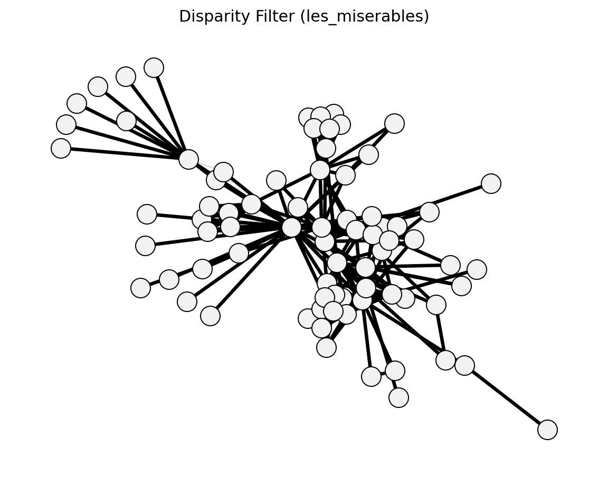

# networkx_backbone

Backbone extraction algorithms for complex networks, built on [NetworkX](https://networkx.org/).

This library provides about 90 functions across 12 modules for extracting backbone
structures from weighted, unweighted, and higher-order (hypergraph) networks.

Full documentation: https://www.brianckeegan.com/networkx_backbone/

## Installation

```bash
pip install networkx-backbone
```

For full functionality (required for statistical tests, bipartite methods, and some structural methods):

```bash
pip install networkx-backbone[full]
```

Or install from source:

```bash
git clone https://github.com/brianckeegan/networkx_backbone.git
cd networkx_backbone
pip install -e ".[full]"
```

## Modules

| Module | Description | Key Functions |
|--------|-------------|---------------|
| **statistical** | Hypothesis-testing methods | `disparity_filter`, `noise_corrected_filter`, `marginal_likelihood_filter`, `ecm_filter`, `lans_filter`, `multiple_linkage_analysis` |
| **structural** | Topology-based methods | `global_threshold_filter`, `strongest_n_ties`, `global_sparsification`, `primary_linkage_analysis`, `edge_betweenness_filter`, `node_degree_filter`, `high_salience_skeleton`, `metric_backbone`, `ultrametric_backbone`, `doubly_stochastic_filter`, `h_backbone`, `modularity_backbone`, `planar_maximally_filtered_graph`, `maximum_spanning_tree_backbone` |
| **proximity** | Neighborhood-similarity scoring | `jaccard_backbone`, `dice_backbone`, `cosine_backbone`, `hub_promoted_index`, `hub_depressed_index`, `adamic_adar_index`, `resource_allocation_index`, `local_path_index`, and more |
| **hybrid** | Combined approaches | `glab_filter` |
| **bipartite** | Bipartite projection backbones | `simple_projection`, `hyper_projection`, `probs_projection`, `ycn_projection`, `sdsm`, `fdsm`, `fixedfill`, `fixedrow`, `fixedcol`, `backbone` |
| **hypergraph** | Higher-order (hypergraph) backbones | `mdl_hypergraph_backbone`, `hypergraph_compression_ratio`, `intersection_graph`, `maximal_hyperedges`, `order_filter`, `s_components`, `statistically_validated_hypergraph`, `statistically_validated_cores` |
| **hypergraph_io** | Hypergraph ingestion and interoperability | `hypergraph_to_bipartite`, `read_hif`, `write_hif`, `from_xgi`/`to_xgi`, `from_hypernetx`/`to_hypernetx`, `from_hypergraphx`/`to_hypergraphx`, `from_hat`/`to_hat` |
| **unweighted** | Sparsification for unweighted graphs | `sparsify`, `lspar`, `local_degree` |
| **filters** | Post-hoc filtering utilities | `multigraph_to_weighted`, `threshold_filter`, `fraction_filter`, `boolean_filter`, `consensus_backbone` |
| **measures** | Evaluation and comparison | `node_fraction`, `edge_fraction`, `weight_fraction`, `reachability`, `ks_degree`, `ks_weight`, `compare_backbones` |
| **visualization** | Graph comparison plotting | `graph_difference`, `compare_graphs`, `save_graph_comparison` |
| **describe** | Methods text and citations | `describe_backbone` |

## NetBone Core Coverage

Core method families used in [netbone](https://gitlab.liris.cnrs.fr/coregraphie/netbone)
(Yassin et al., 2023) are represented here, including:

- Statistical: `disparity_filter`, `marginal_likelihood_filter`, `ecm_filter`, `noise_corrected_filter`, `lans_filter`, `multiple_linkage_analysis`
- Structural: `global_threshold_filter`, `global_sparsification`, `primary_linkage_analysis`, `edge_betweenness_filter`, `high_salience_skeleton`, `doubly_stochastic_filter`, `maximum_spanning_tree_backbone`
- Hybrid: `glab_filter`

Every backbone *model* in Neal's
[Backbone 3.0](https://doi.org/10.1371/journal.pone.0349258) R package is also
covered (`disparity`, `mlf`, `lans`, `sdsm`, `fdsm`, `fixedfill`/`fixedrow`/`fixedcol`,
`bicm`, `fastball`, and the `backbone_from_*` wrappers), including its
hypergraph-projection input via `hypergraph_to_bipartite`, plus its
cross-cutting **features**: multiple-testing correction (`adjust_pvalues`,
`threshold_filter(mtc=...)`), **signed** backbones (`signed=True` adds a `sign`
edge attribute), and **SDSM-EC** edge constraints (`sdsm(prohibited=, required=)`).
See [docs/design/backbone-3.0-coverage.md](docs/design/backbone-3.0-coverage.md)
for the full coverage analysis.

## Quick Start

```python
import networkx as nx
import networkx_backbone as nb

# Create a weighted graph
G = nx.les_miserables_graph()

# 1) Score edges
scored = nb.disparity_filter(G)

# 2) Filter edges
backbone = nb.threshold_filter(scored, "disparity_pvalue", 0.05)

# Compare backbone to original
print(f"Edges kept: {nb.edge_fraction(G, backbone):.1%}")
print(f"Nodes kept: {nb.node_fraction(G, backbone):.1%}")
```

### Significance options: multiple-testing correction and signed backbones

```python
# Correct p-values for the number of edges tested (Bonferroni, Holm, BH/FDR, BY)
backbone = nb.threshold_filter(scored, "disparity_pvalue", 0.05, mtc="bh")

# Signed backbone: keep significantly strong (+1) and significantly weak (-1)
# edges under a two-tailed test; read direction from the "sign" attribute
signed = nb.disparity_filter(G, signed=True)
strong = nb.threshold_filter(signed, "disparity_pvalue", 0.05, mtc="holm")
positives = [(u, v) for u, v, d in strong.edges(data=True) if d["sign"] == 1]
```

### Reporting a backbone (methods text and citations)

`describe_backbone` writes a methods paragraph for the backbone you extracted:
the method and its null model, the parameters, the multiple-testing
correction, the share of nodes, edges and weight kept, and the citations
(including this package and its version). It is the counterpart of Backbone
3.0's `narrative` option.

```python
print(nb.describe_backbone("disparity_filter", alpha=0.05, mtc="bh",
                           original=G, backbone=backbone))
print(nb.describe_backbone("disparity_filter", style="bibtex"))  # BibTeX entries
```

See the [Validating a backbone](https://www.brianckeegan.com/networkx_backbone/tutorials/validating_backbones.html)
tutorial for multiple-testing correction, method comparison, consensus and
signed backbones end to end. To cite the package itself, use
[`CITATION.cff`](CITATION.cff).

### Disparity filter visualization



### Proximity-based scoring

```python
# Score edges by Jaccard similarity of endpoint neighborhoods
scored = nb.jaccard_backbone(G)

# Keep only the top 20% most structurally embedded edges
backbone = nb.fraction_filter(scored, "jaccard", 0.2, ascending=False)
```

### Bipartite backbone

```python
B = nx.davis_southern_women_graph()
women_nodes = [n for n, d in B.nodes(data=True) if d["bipartite"] == 0]
scored = nb.sdsm(B, agent_nodes=women_nodes, projection="hyper")
backbone = nb.threshold_filter(scored, "sdsm_pvalue", 0.05, mode="below")
```

Projection weights follow the simple/hyper/ProbS/YCN formulations compared by
[Coscia & Rossi (2019)](https://doi.org/10.1145/3341161.3342862)
([arXiv:1906.09081](https://arxiv.org/abs/1906.09081)). Their "hyperbolic"
weight is `1/d(z)` per shared artifact; pass `hyper_projection(..., newman=True)`
(or `projection="newman"`) for Newman's (2001) `1/(d(z) - 1)` collaboration
weight, which matches `nx.bipartite.collaboration_weighted_projected_graph`.

Every bipartite function also takes an agents x artifacts incidence matrix
(NumPy, SciPy sparse or pandas) instead of a graph, as R `backbone` does.
The incidence stays sparse and pairs are scored in blocks of agent rows:

```python
import scipy.sparse as sp

M = sp.random_array((20_000, 5_000), density=0.01, format="csr")
M.data[:] = 1
backbone = nb.backbone_from_projection(M, method="sdsm", alpha=0.01)
```

### Hypergraph backbones

Backbone a hypergraph (a collection of arbitrary-size hyperedges) directly:

```python
# Parameter-free MDL backbone -- prunes nested/redundant hyperedges
# (Kirkley, Felippe, Malizia & Battiston, 2026)
H = [(1, 2, 3, 4), (1, 2, 3), (2, 3, 4), (8, 9)]
result = nb.mdl_hypergraph_backbone(H)          # method="auto" runs both greedy
print(result.backbone)            # [frozenset({1, 2, 3, 4}), frozenset({8, 9})]
print(result.compression_ratio)   # inverse compression ratio eta
# method="edge" (fastest single pass) or "node" are also available

# Statistically validated hypergraph (Musciotto, Battiston & Mantegna, 2021)
events = [(1, 2)] * 5 + [(3, 4)] * 100          # repeats = interaction counts
svh = nb.statistically_validated_hypergraph(events, alpha=0.05)
```

Interoperate with the higher-order ecosystem (all optional, lazily imported), or
reuse the bipartite projection backbones via the incidence graph:

```python
B, nodes = nb.hypergraph_to_bipartite(H)        # -> NetworkX bipartite graph
scored = nb.sdsm(B, agent_nodes=nodes)          # projection backbone of a hypergraph

nb.write_hif(H, "graph.hif")                    # HIF interchange (xgi/HNX/HGX/HAT)
edges = nb.from_xgi(xgi_hypergraph)             # xgi / hypernetx / hypergraphx / hat
```

### Comparing multiple methods

```python
backbones = {
    "disparity": nb.threshold_filter(nb.disparity_filter(G), "disparity_pvalue", 0.05),
    "mst": nb.boolean_filter(nb.maximum_spanning_tree_backbone(G), "mst_keep"),
}
results = nb.compare_backbones(G, backbones)
```

## Dependencies

- **Required**: Python >= 3.12, `networkx >= 3.4` (version floors match NetworkX's own)
- **Optional**: `numpy >= 2.2`, `scipy >= 1.15` (`[full]`: some statistical methods, bipartite null models, SVH/SVC, `doubly_stochastic_filter`, `local_path_index`, KS measures) and `matplotlib >= 3.10` (`[viz]`: visualization helpers and the docs gallery). Calling a function whose optional dependency is missing raises `ImportError`; the pure-Python methods work with NetworkX alone.
- **Hypergraph interop (optional, lazily imported)**: `xgi >= 0.9.1`, `hypernetx >= 2.3.10`, `hypergraphx >= 1.7.7`, `HypergraphAnalysisToolbox >= 1.1.18` (extras `[xgi]`, `[hypernetx]`, `[hypergraphx]`, `[hat]`, or all four with `[interop]`)

## Testing

```bash
pip install -e ".[dev]"
pytest --doctest-modules networkx_backbone tests   # tests + docstring examples
ruff check networkx_backbone tests && ruff format --check networkx_backbone tests
```

## Roadmap

Planned work, open gaps, and recently completed milestones are tracked in the
[roadmap](https://www.brianckeegan.com/networkx_backbone/roadmap.html)
([source](docs/roadmap.rst)).

## Visualization gallery

Backbone visualizations in the docs are generated with **Sphinx Gallery** from
example scripts under `docs/examples/`.

Build docs (including the graph comparison gallery and function-linked
visualizations):

```bash
pip install -e ".[docs]"
sphinx-build -b html docs docs/_build/html
```

## References

Key papers behind the implemented methods:

- Coscia, M. & Neffke, F. M. (2017). [Network backboning with noisy data](https://doi.ieeecomputersociety.org/10.1109/ICDE.2017.100). *Proc. IEEE ICDE*, 425-436.
- Coscia, M. & Rossi, L. (2019). [The impact of projection and backboning on network topologies](https://doi.org/10.1145/3341161.3342862). *Proc. IEEE/ACM ASONAM*. [arXiv:1906.09081](https://arxiv.org/abs/1906.09081).
- Dianati, N. (2016). [Unwinding the hairball graph: Pruning algorithms for weighted complex networks](https://doi.org/10.1103/PhysRevE.93.012304). *Physical Review E*, 93, 012304.
- Foti, N. J., Hughes, J. M., & Rockmore, D. N. (2011). [Nonparametric sparsification of complex multiscale networks](https://doi.org/10.1371/journal.pone.0016431). *PLoS One*, 6(2), e16431.
- Girvan, M., & Newman, M. E. J. (2002). [Community structure in social and biological networks](https://doi.org/10.1073/pnas.122653799). *PNAS*, 99(12), 7821-7826.
- Godard, K., & Neal, Z. P. (2022). [fastball: A fast algorithm to sample bipartite graphs with fixed degree sequences](https://doi.org/10.1093/comnet/cnac049). *J. Complex Networks*, 10(6), cnac049.
- Gemmetto, V., Cardillo, A., & Garlaschelli, D. (2017). [Irreducible network backbones: unbiased graph filtering via maximum entropy](https://arxiv.org/abs/1706.00230). arXiv:1706.00230.
- Grady, D., Thiemann, C., & Brockmann, D. (2012). [Robust classification of salient links in complex networks](https://doi.org/10.1038/ncomms1847). *Nature Communications*, 3, 864.
- Hamann, M., Lindner, G., Meyerhenke, H., Staudt, C. L., and Wagner, D. (2016). [Structure-Preserving Sparsification Methods for Social Networks](https://doi.org/10.1007/s13278-016-0332-2). Social Network Analysis and Mining, 6, 22.
- Simas, T., Correia, R. B., & Rocha, L. M. (2021). [The distance backbone of complex networks](https://doi.org/10.1093/comnet/cnab021). *J. Complex Networks*, 9(6), cnab021.
- Newman, M. E. J. (2001). [Scientific collaboration networks. II. Shortest paths, weighted networks, and centrality](https://doi.org/10.1103/PhysRevE.64.016132). *Physical Review E*, 64, 016132.
- Neal, Z. P. (2014). [The backbone of bipartite projections](https://doi.org/10.1016/j.socnet.2014.06.001). *Social Networks*, 39, 84-97.
- Neal, Z. P., Domagalski, R., & Sagan, B. (2021). [Comparing alternatives to the fixed degree sequence model for extracting the backbone of bipartite projections](https://doi.org/10.1038/s41598-021-03238-3). *Scientific Reports*, 11, 23929.
- Neal, Z. P. (2022). [backbone: An R package to extract network backbones](https://doi.org/10.1371/journal.pone.0269137). *PLoS One*, 17(5), e0269137.
- Neal, Z. P. (2026). [Backbone 3.0: An R package for extracting network backbones](https://doi.org/10.1371/journal.pone.0349258). *PLoS One*, 21, e0349258.
- Neal, Z. P., & Neal, J. W. (2023). [Stochastic Degree Sequence Model with Edge Constraints (SDSM-EC) for Backbone Extraction](https://doi.org/10.1007/978-3-031-53468-3_11). *Complex Networks 12*, 127-136.
- Saracco, F., Di Clemente, R., Gabrielli, A., & Squartini, T. (2015). [Randomizing bipartite networks: the case of the World Trade Web](https://doi.org/10.1038/srep10595). *Scientific Reports*, 5, 10595.
- Satuluri, V., Parthasarathy, S., & Ruan, Y. (2011). [Local graph sparsification for scalable clustering](https://doi.org/10.1145/1989323.1989399). *SIGMOD*, 721-732.
- Serrano, M. A., Boguna, M., & Vespignani, A. (2009). [Extracting the multiscale backbone of complex weighted networks](https://doi.org/10.1073/pnas.0808904106). *PNAS*, 106(16), 6483-6488.
- Van Nuffel, N. (2007). [Determination of the number of significant flows in origin-destination specific analysis: the case of commuting in Flanders](https://doi.org/10.1080/00343400701281808). *Regional Studies*, 41(4), 509-524.
- Weaver, J. C. (1954). [Crop-combination regions in the Middle West](https://doi.org/10.2307/212355). *Geographical Review*, 44(2), 175-200.
- Yildirim, M. A., & Coscia, M. (2014). [Using random walks to generate associations between objects](https://doi.org/10.1371/journal.pone.0104813). *PLoS One*, 9(8), e104813.
- Zhang, X., Zhang, Z., Zhao, H., Wang, Q., & Zhu, J. (2014). [Extracting the globally and locally adaptive backbone of complex networks](https://doi.org/10.1371/journal.pone.0100428). *PLoS One*, 9(6), e100428.
- Zhou, T., Ren, J., Medo, M., & Zhang, Y.-C. (2007). [Bipartite network projection and personal recommendation](https://doi.org/10.1103/PhysRevE.76.046115). *Physical Review E*, 76, 046115.
- Yassin, A., Haidar, A., Cherifi, H., Seba, H., & Togni, O. (2023). [An evaluation tool for backbone extraction techniques in weighted complex networks](https://doi.org/10.1038/s41598-023-42076-3). *Scientific Reports*, 13, 17000. 
- Yassin A., Cherifi, H., Seba, H., & Togni, O. (2025). [Backbone extraction through statistical edge filtering: A comparative study](https://doi.org/10.1371/journal.pone.0316141). *PLoS One*, 20(1): e0316141.
- Yassin A., Cherifi, H., Seba, H., & Togni, O. (2025). [Exploring weighted network backbone extraction: A comparative analysis of structural techniques](https://doi.org/10.1371/journal.pone.0322298). *PLoS One*, 20(5): e0322298.

Other libraries and datasets:

- Yassin, A., Haidar, A., Cherifi, H., Seba, H., & Togni, O. (2023). [netbone](https://gitlab.liris.cnrs.fr/coregraphie/netbone).
- Yassin, A., et al. (2025). [structural-backbone-methods-comparison](https://github.com/al1yass2n/structural-backbone-methods-comparison).
- Neal, Z. (2022). [backbone](https://rbackbone.net/).
- Chrol, B. & Bojanowski, M. (2018). [Proximity-based Methods for Link Prediction](https://cran.r-project.org/web/packages/linkprediction/vignettes/proxfun.html).

## License

BSD 3-Clause License. See [LICENSE](LICENSE) for details.
